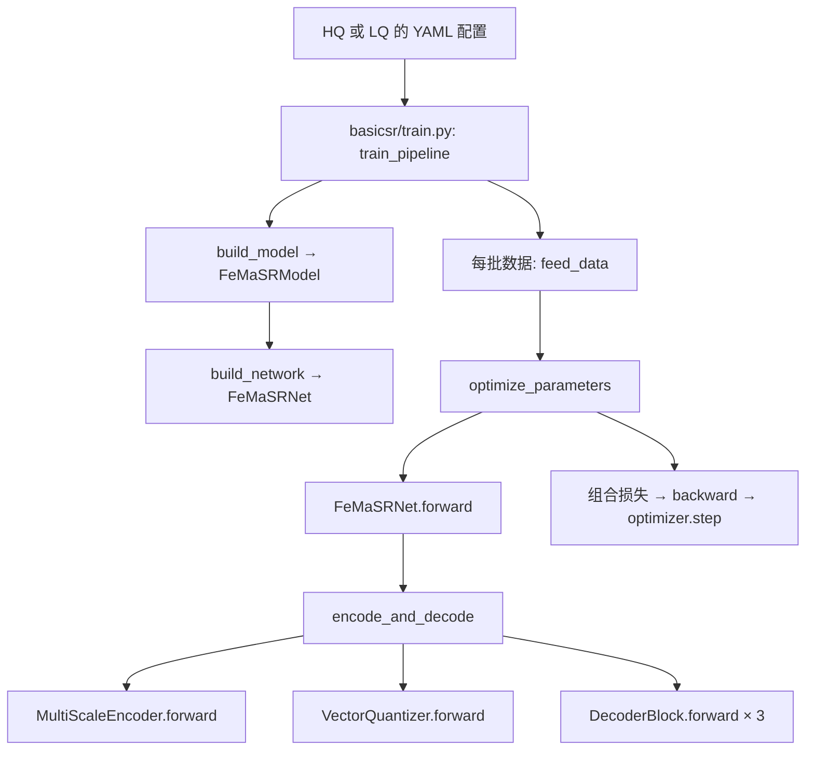

# FeMaSR 官方代码：从训练入口到图像输出

本导读对应 `freq-VQ/FeMaSR` 的官方提交 `1ca4295a2430057407f32d0d3fba70270ca68ce7`。`femasr_arch.py` 已添加中文阅读注释，计算逻辑仍与官方一致。以下只描述官方默认的单码本、×4 配置，不是旧小波实验的流程。

快速跳转：[训练入口](FeMaSR/basicsr/train.py) · [训练控制器](FeMaSR/basicsr/models/femasr_model.py) · [网络架构](FeMaSR/basicsr/archs/femasr_arch.py) · [HQ 配置](FeMaSR/options/train_FeMaSR_HQ_pretrain_stage.yml) · [LQ 配置](FeMaSR/options/train_FeMaSR_LQ_stage.yml)。

## 先分清两个“模型”

| 名称 | 文件 | 负责什么 |
|---|---|---|
| `FeMaSRModel` | `FeMaSR/basicsr/models/femasr_model.py` | BasicSR 的训练控制器：创建网络、加载 HQ 权重、冻结模块、计算损失、反向传播、更新优化器、验证。 |
| `FeMaSRNet` | `FeMaSR/basicsr/archs/femasr_arch.py` | 生成器网络：一次前向中编码、量化、解码，返回图像及辅助损失/索引。 |

因此 `FeMaSRNet.forward` 是**一次网络前向的入口**，不是完整训练循环；完整训练循环在 `basicsr/train.py` 与 `FeMaSRModel.optimize_parameters`。

`YAML` 的 `model_type: FeMaSRModel` 选训练控制器；`network_g.type: FeMaSRNet` 选生成器。两个类均通过 BasicSR 注册表构建。官方启动方式为 `python basicsr/train.py -opt options/train_FeMaSR_HQ_pretrain_stage.yml`，第二阶段换为 `train_FeMaSR_LQ_stage.yml`。

## 第一阶段：HQ 高质量图像预训练

配置：`options/train_FeMaSR_HQ_pretrain_stage.yml` 中 `LQ_stage: false`，`gt_resolution: 256`，`codebook_params: [[32,1024,512]]`。训练数据的 `gt` 是 256×256 高质量图像；虽然数据加载器也返回 `lq`，本阶段生成器前向只读 `gt`。

1. `train_pipeline` 取一个 batch，依次调用 `model.feed_data(data)` 和 `model.optimize_parameters(iter)`。
2. `FeMaSRModel.optimize_parameters` 调用 `self.net_g(self.gt)`，即 `FeMaSRNet.forward(gt)`；没有 HQ 教师网络，也不传 `gt_indices`。
3. `FeMaSRNet.encode_and_decode` 调用 `MultiScaleEncoder(gt)`。编码器逐级下采样，形成约 128×128、64×64、32×32 的特征，之后将列表翻转，从 32×32 开始解码。
4. 在默认唯一的 32×32 码本尺度，`before_quant_group` 的 1×1 卷积把特征映射到 512 维；`VectorQuantizer` 为每个位置从 1024 个码字里找最近的一个，返回量化特征和索引。
5. `after_quant_group` 把码字特征变成解码器需要的通道；三个 `DecoderBlock` 依次放大 32→64→128→256，`out_conv` 输出重建的 256×256 图像。默认只在 32×32 量化；64、128 两级没有新增码本。
6. `FeMaSRModel` 对重建图和真值图计算配置指定的像素、感知、GAN、码本及语义损失，再反向传播、更新生成器和判别器。这里的原版码本是可训练的 `nn.Embedding`，通过梯度优化；训练得到的 HQ 先验权重包含供第二阶段使用的码本与解码器。

## 第二阶段：LQ 低质量图像超分训练

配置：`options/train_FeMaSR_LQ_stage.yml` 中 `LQ_stage: true`，`scale_factor: 4`，同一个 32×32 码本。训练样本是一对 64×64 LQ 图和 256×256 GT 图。

**准备阶段**：`FeMaSRModel.__init__` 建立 LQ 生成器 `net_g`，再建立 HQ 教师 `net_hq`；两者加载同一份 HQ 预训练权重。配置中的 `frozen_module_keywords` 使 LQ 生成器的 `quantize_group`、`decoder_group`、`after_quant_group`、`out_conv` 冻结。`multiscale_encoder` 与 `before_quant_group` 仍可训练。HQ 教师在下面的前向调用中使用 `torch.no_grad()`，不通过该次调用更新。

**每次训练迭代**按以下顺序：

1. `net_hq(gt)`：HQ 教师看 256×256 真值图，给出 32×32 网格上每个位置的目标码本索引 `gt_indices`。
2. `net_g(lq, gt_indices)`：LQ 生成器看 64×64 输入图。其编码器先下采样到约 32×32，经 Swin 上下文模块，再向上生成约 64×64、128×128 的特征；网络取这三个尺度用于解码。
3. 32×32：`before_quant_group` 产生待量化特征 `z`；量化器根据 `z` 自己选最近码字 `z_q` 作为实际前向输出，同时使用教师的 `gt_indices` 查到目标码字 `z_q_gt`，计算对齐损失。教师索引不会直接替换 LQ 自己选出的前向码字。
4. 64×64 和 128×128：默认没有第二、第三个码本；如果 `use_residual=True`，将相应的 LQ 编码特征加到解码特征，再逐级放大。最后输出 256×256 SR。
5. `FeMaSRModel` 将 SR 与 GT 比较，计算配置中的码本、像素、感知、GAN 等损失，反向传播并更新未冻结的生成器参数及判别器。此阶段不再重新学习已冻结的码本和解码器。

**推理时**只输入 LQ 图。`FeMaSRModel.test` 调用 `FeMaSRNet.test`（大图可调用 `test_tile`），后者最终进入 `encode_and_decode(input)`；没有 GT 图和 HQ 教师索引。

## 在哪里读、在哪里改

| 想理解或修改的内容 | 首先看哪里 |
|---|---|
| 数据集来源、patch 尺寸、网络配置、损失开关、预训练权重路径 | `FeMaSR/options/train_FeMaSR_HQ_pretrain_stage.yml` 和 `train_FeMaSR_LQ_stage.yml` |
| 训练循环、取 batch、验证与保存 | `FeMaSR/basicsr/train.py` 的 `train_pipeline` |
| HQ 教师、冻结、损失、反向传播 | `FeMaSR/basicsr/models/femasr_model.py` 的 `__init__`、`optimize_parameters` |
| 编码器结构及 HQ/LQ 多尺度特征 | `FeMaSR/basicsr/archs/femasr_arch.py` 的 `MultiScaleEncoder` |
| 量化前处理、量化位置、解码顺序、连续特征残差路径 | 同文件的 `FeMaSRNet.encode_and_decode` |
| 最近码字搜索、HQ 索引监督、码本损失 | 同文件的 `VectorQuantizer.forward` |
| 每一级怎样放大特征 | 同文件的 `DecoderBlock` |

如果新想法只改变网络内部计算，并维持 `FeMaSRNet.forward` 的输入输出形式，主要可能改 `femasr_arch.py`。如果需要新的训练目标、额外监督输入、冻结规则或数据处理，则还要检查 `femasr_model.py`、YAML 或数据集代码；是否能“只改 arch”取决于最终方案。
